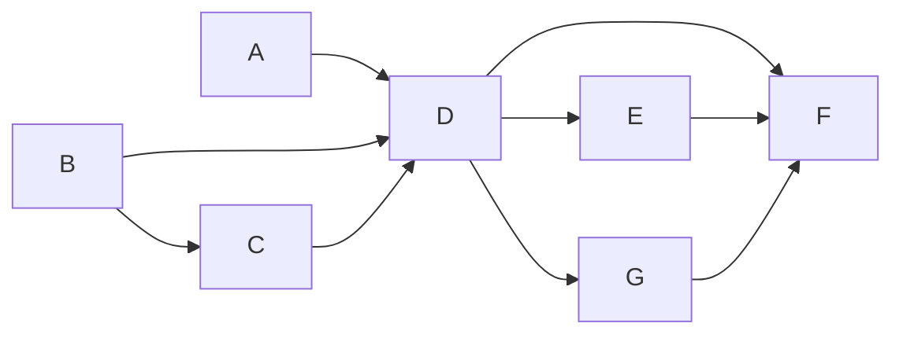

# OMP Integration Simplification Against the Current OpenCode Baseline

- 日期：2026-10-14。

- 狀態：設計方向已經使用者核准，全套 7 項 OpenSpec 提案已規劃並提交至 master；尚未授權實作（無 feat 分支、無實作工作樹）。獨立審閱阻礙狀態如文內紀錄。

## 1. 目的與決策

以 AIr-Friends 專案內目前的 OpenCode 行為作為預期結果，OMP 作為待改善對象。移除 OMP 額外的安全政策、過度驗證與無實際用途的設計，保留達到對等行為所需的原生介面適配。

OpenCode 不因這次工作增加防護、限制或驗證。既有 OMP 規格不能用來證明 OMP 額外政策必須保留；與本次核准方向衝突的需求需要更新或移除。

使用者已核准以下決策。

- 按功能對應 OpenCode 的允許、詢問與拒絕政策。OpenCode 受限設定的 `permission["*"] = "deny"` 屬於明確處置，沒有對應的 OMP 工具沿用預設拒絕。
- OpenCode 未處理的事項，OMP 同樣不增加處理。未處理不等於拒絕、允許，亦不等於新增「必須不處理」的斷言。
- 採用原生工具、薄適配層與共用授權程式碼。共用遵循單一職責原則，不建立通用代理治理框架。
- 每種代理直接讀取各自手寫的原生設定。OpenCode JSON 不作為 OMP 設定產生器的輸入。
- OMP 設定在執行期與建置期均不得產生、序列化、改寫或套用自訂模板。建置可以原樣複製已追蹤的設定檔。
- 自訂部署的技能目錄由部署者同步設定於 `agent.skillsDir` 與 OMP 原生 YAML，不建立插值器或一致性拒絕閘門。
- OMP 保留原生 ACP 所需的受限／YOLO 分行程，取消不必要的設定來源、所有權及命名空間驗證。

本文將 session 稱為工作階段；程式符號與原生參數仍使用原名。

## 2. 基準與證據

本次探索所見最近提交為 `bee9ebc`，合併單一技能樹封裝變更。OpenCode 基準是當前工作樹中的實作，不是較早 OMP 提案所描述的理想化 OpenCode。

| 基準位置 | 用途 |
|---|---|
| `agent-config/opencode.json:29-112` | `build` 與 `yolo` 的原生權限設定 |
| `src/acp/agent-factory.ts:207-332` | OpenCode 環境、工作目錄、暫存、出口設定與啟動 |
| `src/acp/agent-factory.ts:548-552` | OpenCode YOLO 的 ACP 模式切換 |
| `src/acp/client.ts:690-1253` | 共用 ACP 權限請求處理 |
| `src/acp/client.ts` | ACP 檔案讀寫回呼與逐工作階段脈絡 |
| `src/core/skills-root.ts:101-184` | 兩種代理共用的技能根目錄解析與觀察 |
| `src/utils/opencode-paths.ts` | 既有 OpenCode 技能探索宣告更新 |
| `src/core/agent-process-pool.ts:60-69` | OpenCode 與 OMP 的目前池鍵差異 |
| `src/acp/agent-connector.ts:1280-1463` | 目前復原流程與 OpenCode 的可選脈絡路徑 |
| `Containerfile` | 版本下載校驗、檔案安裝與權限慣例 |

已實際呼叫 `poolEntryKey()`，同一對話鍵在 OpenCode 兩種模式下相同，OMP 則加上模式後綴。這項觀察只證明池鍵函式結果，不證明真實代理權限或行程隔離。

原生 OMP 證據釘選至 `v18.6.1`，commit `2a2c6dcbbb558c0f8145f67f28b3370984f2bf60`。

- [OMP 批准模式文件](https://github.com/can1357/oh-my-pi/blob/2a2c6dcbbb558c0f8145f67f28b3370984f2bf60/docs/approval-mode.md)明示 ACP 沒有逐工作階段的批准政策欄位，需要分開啟動行程或使用啟動設定。
- [OMP ACP 模式實作](https://github.com/can1357/oh-my-pi/blob/2a2c6dcbbb558c0f8145f67f28b3370984f2bf60/packages/coding-agent/src/modes/acp/acp-agent.ts)的模式選單處理一般／規劃模式，不可把 OpenCode 的 `yolo` 模式名稱直接套用。
- [OMP 原生檔案橋接](https://github.com/can1357/oh-my-pi/blob/2a2c6dcbbb558c0f8145f67f28b3370984f2bf60/packages/coding-agent/src/tools/acp-bridge.ts)會把普通檔案寫入交給 ACP；客戶端寫入錯誤會傳回工具錯誤。內部資源另走原生路徑，不能宣稱所有修改都經過此橋接。
- [OMP 技能探索](https://github.com/can1357/oh-my-pi/blob/2a2c6dcbbb558c0f8145f67f28b3370984f2bf60/packages/coding-agent/src/extensibility/skills.ts)對 `skills.customDirectories` 使用 `expandTilde()`；本次未找到任意環境變數插值機制。

前一份功能對照文件宣稱 OpenCode 不會探索工作區工具或外掛，這項結論需要修正。[OpenCode 自訂工具文件](https://opencode.ai/docs/custom-tools/)及[外掛文件](https://opencode.ai/docs/plugins/)都列有工作區探索位置；這兩份線上文件未釘選版本。原始碼核對與後續驗收不得再把「沒有專案端預檢」誤寫成「上游沒有探索能力」。

尚未進行真實代理、容器、付費模型或平台投遞驗收。設定代理環境變數不等於已證明流量經過代理。

## 3. 架構與責任

### 3.1 手寫的原生設定

OpenCode 繼續直接讀取自己的 JSON。既有 OpenCode 技能探索宣告更新維持原狀，本次不擴大或改寫其行為。

OMP 繼續使用原生 YAML 與原生模型設定檔，由原生參數指定檔案路徑。受限與 YOLO 可以各有手寫文件，兩者不必共用由程式產生的內容，也不需要證明檔案集合相互排斥。

移除下列設計。

- `src/acp/omp/skill-root-declaration.ts` 的啟動期宣告產生與寫入。
- `src/acp/omp-settings.ts` 與 YAML 重複的整份內容字串、固定 schema 鏡像、設定疊加模擬與完整重驗。
- `assertOwnedSettingsDocument()` 在啟動時重複解析與拒絕原生設定的流程。
- 為技能目錄或其他設定新增的執行期／建置期轉譯器與模板。

原生設定錯誤依 OMP 自己的解析與啟動錯誤回報。應用程式可選擇設定檔路徑，但不自行定義一套比原生格式更窄的合法值集合。

### 3.2 共用授權

共用 ACP 客戶端仍負責既有的權限請求、命令判定、檔案修改授權、破壞性操作正規化，以及保護檔案讀寫回呼。

同一模組被匯入不代表兩種代理經過同一條路徑。每條原生路徑必須分清楚原生自動批准、ACP 權限請求與 ACP 檔案回呼；不能把回呼專屬的副檔名或身分驗證強加到 OpenCode 原生自動批准的讀取工具。

若原生請求形狀不同，適配只正規化工具名稱、參數與必要目標，接著使用既有判定。不得重寫第二份命令解析、路徑政策、技能腳本清單或破壞性操作政策。

### 3.3 OMP 薄適配層

薄適配的責任限於原生介面差異及預設拒絕。

- 功能映射記錄哪些 OMP 工具對應 OpenCode 的讀取、搜尋、待辦、技能、修改及執行能力。
- 原生 YAML 決定原生可表達的批准政策；不讀取 OpenCode JSON 來決定 OMP 執行結果。
- OMP 原生設定不能表達的萬用字元預設拒絕，由小型工具呼叫處理器補足。這份映射只列對應能力，不列舉所有假想工具或裝置。
- 已有原生 ACP 路徑的呼叫直接使用原生路徑，不再加一層相同的授權。
- 普通原生檔案寫入沿用 `writeTextFile` 回呼。破壞性請求的原生目標資訊差異需要在輸入適配中處理，不保留因缺少虛構來源證據而整批拒絕的流程。
- 原生 API 註冊仍使用官方介面，保留必要的原生可載入綑綁檔。不引入新的控制通道、準備狀態協定或授權 API 伺服器。

刪除工具來源認證、MCP 所有權認證、登記表世代、資源世代、模組實體身分及準備狀態契約等 OMP 專屬前提。

### 3.4 破壞性請求的 ACP 入口適配

OMP 的原生權限橋接可能省略工具種類，原生搬移參數也不同於共用解碼器。適配位於 ACP 客戶端的請求入口，代理類型來自連接器設定，不接受請求自行宣稱代理類型或解析器來源。

OMP 刪除請求以原生刪除標題及完整 `rawInput.path` 辨識；搬移請求以原生搬移標題及完整起點、終點辨識。搬移起點依原生順序讀取 `oldPath`、`path`、`from`，終點讀取 `newPath`、`to`、`destination`，正規化為共用的 `source`、`destination`。標題只協助辨識請求種類，不提供目標或授權。

適配後仍由同一份 `decodeDestructiveIntent()`、`normalizeDestructiveIntent()` 及全目標授權決定結果。原始輸入保留供既有診斷使用；正規化輸入及其執行綁定使用同一份表示，不接受呼叫者注入的操作清單。

| 原生情況 | 入口適配與共用政策 |
|---|---|
| 完整的單一刪除 | 正規化為共用刪除輸入，授權實際目標 |
| 完整的單一搬移 | 正規化為共用搬移輸入，授權起點及終點 |
| 缺少目標、只有標題或缺少搬移端點 | 保持共用的不完整輸入拒絕 |
| 目標與位置清單不符、原生只提供部分位置 | 保持共用完整性判定，不自行補造位置或授權缺少的端點 |
| 原生 edit／patch 內嵌刪除或搬移 | 不把第一項操作誤當完整請求；使用現有不支援語法判定，不為 OMP 擴大共用解碼器 |

OpenCode 請求不經過 OMP 正規化，原有結果包含不支援的 patch 判定都不變。不增加擴充端的工作階段授權通道。

## 4. 政策對照

| 能力或事項 | OpenCode 現況 | OMP 目標 |
|---|---|---|
| 受限預設工具政策 | `*` 拒絕，個別工具另設允許或詢問 | 功能對應後取得相同判定，未知工具預設拒絕 |
| 讀取與本地搜尋 | 原生工具允許；可能另有外部目錄權限路徑 | 原生工具，不追加來源／inode 驗證；核對實際外部目錄行為 |
| 待辦與技能 | 原生工具允許 | 對應原生能力，不增加技能等級或世代驗證 |
| Bash | 原生模式與命令設定，再由 ACP 閘門判定允許的請求 | 原生 ACP 路徑及共用命令判定 |
| 修改與破壞性操作 | 原生權限請求及共用授權 | 正規化原生輸入後使用同一政策；普通寫入使用既有回呼 |
| YOLO | 原生寬鬆模式，保留明確 `lsp` 拒絕 | 原生寬鬆模式及相同明確例外 |
| LSP 工具 | 兩個 agent 都明確拒絕，沒有全域停用設定 | 使用原生工具拒絕，不保留 `--no-lsp` 或全域 `lsp.enabled: false` |
| 隱含語言伺服器啟動 | 本專案未設等價全域抑制 | 不新增抑制、不新增「必須啟動／不啟動」斷言 |
| 工具來源與登記表世代 | 沒有 OMP 式驗證 | 不驗證，不用同名工具來源變化另造拒絕 |
| 工作區可執行探索 | 沒有專案端可執行檔預檢 | 原生探索，不掃描並拒絕工作區 |
| 設定來源與設定檔替換 | 沒有 OMP 式啟動前身分驗證 | 原生設定探索與載入，不建立替換閘門 |
| URL 讀取與網頁搜尋 | 原生工具及現有出口設定 | 原生工具及同一出口設定，不自建傳輸或後端名單 |
| Provider 設定 | 設定既有供應商與憑證，不維護其他供應商的禁用清單 | 手寫原生供應商設定，刪除額外的完整 `disabledProviders` 禁用清單 |
| 技能根目錄 | 共用解析器及腳本清單 | 同一解析器與清單；原生 YAML 的探索路徑由部署者管理 |
| 技能碰撞與 `skill://` | 原生探索與讀取，沒有 OMP 信任階梯 | 原生探索與讀取，不另設關鍵技能或 URI 中繼資料驗證 |

URL 重導向、搜尋後端與結果格式保留原生差異，不引入新傳輸來追求逐位元組一致。若驗收發現必要能力不可用，需指出具體缺少的原生能力，不得以沒有 OpenCode 對應的額外政策代替功能。

## 5. 啟動、行程池與復原

### 5.1 最小模式例外

保留 OMP 受限／YOLO 分行程及相應池鍵區分，理由限於固定版本原生 ACP 沒有逐工作階段的批准政策切換。此例外不授權其他 OMP 專屬所有權框架。

可變狀態使用現有行程／對話資料目錄的慣例，只在原生確實需要的資料目錄保留模式區分。移除額外的隔離 `HOME`、中立目錄證明、來源計畫及逐請求命名空間重驗。保留每個工作階段的暫存內容位置、JWT、共享行程目前工作階段指標及使用者工作目錄，不能以原生行程資料目錄取代它們。

### 5.2 復原共用

復原從既有連接器選項重新啟動並載入工作階段，使用既有能力偵測與失敗回報。OMP 不再強制要求額外的所有權記錄或完整脈絡證明。

OpenCode 目前使用的可選復原脈絡與其判定維持不變。移除的是 OMP 專屬的強制入口、預先完整性比較、設定／可執行檔預檢及重複驗證；不能為刪除 OMP 規則順便改變 OpenCode 現有路徑。

共享行程的逐工作階段政策脈絡仍需正確綁定。這項共用責任不等於保留 OMP 的來源與命名空間授權框架。

## 6. 技能與封裝

技能讀取與探索交回原生實作。共用 `observeTrustedSkillsRoot()`、腳本清單、提示中的實際腳本路徑、暫存檔與技能驗證保持原有職責。

取消 OMP 的 `PINNED_CRITICAL_SKILLS`、關鍵技能身分產生、根目錄 inode 基準、技能世代、唯讀階梯與 `skill://` 中繼資料檢查。目前固定的 `review`、`destructive`、`lsp`、`readiness` 均不在本專案內建技能樹中；不補造這些技能來滿足舊設計。

封裝沿用 OpenCode 的固定版本與每架構下載校驗慣例。授權聲明的正常發行封裝保留，不因取消額外信任框架而刪除應有授權文件。

若薄適配需要擴充模組，建置只產生原生可載入的單一 ESM 產物。此產物屬於程式碼建置，與禁止產生 OMP 設定檔分開處理。

取消部署身分宣告、每次呼叫的實體檔案證據、不可寫自有治理樹與額外 `PACKAGE-MANIFEST.sha256` 重算規則。下載檔案的 SHA-256 校驗保留；不能把下載校驗與內部產物摘要清單視為同一需求。

檔案權限採本專案目前 OpenCode 安裝慣例，不另建立 OMP 專屬不可寫政策。移除對應的 UID、mode、inode 及部署面測試斷言。

## 7. 原有 37 項的完整處置表

編號沿用 `docs/omp-features/matrix.md`。每一列均須納入後續實作計畫，不因分拆子計畫而省略。

| 編號 | 功能 | 處置與理由 | 主要受影響位置 | 測試與規格位置 |
|---|---|---|---|---|
| 1 | 可選代理類型 | 保留共用類型、預設與載入驗證 | `src/acp/types.ts`、`src/acp/agent-factory.ts` | `tests/acp/agent-factory-omp.test.ts`；`openspec/specs/acp-integration/spec.md` |
| 2 | 相容性契約與稽核 | 刪除無執行用途的完整治理契約與固定姿態斷言；保留必要原生差異的文件證據 | `src/acp/omp/compatibility-contracts.ts` 及契約驗證器 | `tests/acp/omp-compatibility-contracts.test.ts`；`openspec/specs/acp-integration/spec.md` |
| 3 | 模式分離自有設定 | 簡化為各模式手寫原生 YAML，取消程式中的設定鏡像與重驗 | `src/acp/omp-settings.ts`、`agent-config/omp/` | `tests/acp/omp-settings.test.ts`；`openspec/specs/acp-integration/spec.md` |
| 4 | 設定探索來源隔離 | 刪除 OMP 強制隔離與身分預檢 | `src/acp/omp/settings-sources.ts`、`src/acp/sandbox-manager.ts` | `tests/acp/omp-settings-sources.test.ts`；`openspec/specs/acp-integration/spec.md` |
| 5 | 兩模式 LSP 停用 | 改為原生工具拒絕，刪除全域停用及冷啟動抑制契約 | OMP YAML、`src/acp/agent-factory.ts`、LSP 驗證器 | `tests/acp/omp-lsp-coldstart-evidence.test.ts`；`openspec/specs/acp-integration/spec.md` |
| 6 | 模式化啟動 | 保留必要的原生模式選擇，刪除設定產生、重驗與多餘狀態路徑 | `src/acp/agent-factory.ts`、`src/utils/omp-paths.ts` | `tests/acp/agent-factory-omp.test.ts`；`openspec/specs/acp-integration/spec.md` |
| 7 | 模式化行程池 | 保留原生協定所需的模式區分，取消額外所有權框架 | `src/core/agent-process-pool.ts` | `tests/core/omp-pool-modes.test.ts`；`openspec/specs/shared-acp-process-pool/spec.md` |
| 8 | 載入前排除與關鍵技能 | 刪除；OpenCode 沒有對等專案端處理 | `src/acp/omp/discovery-guard.ts`、擴充 bootstrap | `tests/acp/omp-discovery-guard.test.ts`；`openspec/specs/acp-integration/spec.md` |
| 9 | 工作區可執行檔預檢 | 刪除掃描、拒絕與生命週期接線 | `src/acp/omp/executable-sources.ts`、`src/acp/agent-connector.ts` | `tests/acp/omp-executable-sources.test.ts`；`openspec/specs/acp-integration/spec.md` |
| 10 | 受限工具清單 | 簡化為必要功能映射與預設拒絕，取消假想工具禁用表與路由矩陣 | `src/acp/omp/tool-inventory.ts` | `tests/acp/omp-restricted-tool-decisions.test.ts`；`openspec/specs/acp-integration/spec.md` |
| 11 | 執行期工具強制 | 只保留原生設定缺少的薄適配；刪除來源與世代前提 | `src/acp/omp/tool-enforcement-wiring.ts`、`extension/enforcement.ts` | `tests/acp/omp-tool-enforcement-wiring.test.ts`；`openspec/specs/acp-integration/spec.md` |
| 12 | 原生擴充接線 | 保留必要的官方 API 註冊，刪除登記表與證據框架 | `src/acp/omp/extension/native-registration.ts` | `tests/acp/omp-native-registration.test.ts`；`openspec/specs/acp-integration/spec.md` |
| 13 | 原生內建工具來源認證 | 刪除來源 tuple 認證；改按對應工具政策 | `src/acp/omp/tool-provenance.ts` | `tests/acp/omp-restricted-tool-decisions.test.ts`；`openspec/specs/acp-integration/spec.md` |
| 14 | 模組實體部署證據 | 刪除部署面、anchor、實體檔案與每次呼叫重驗 | `src/acp/omp/deployment-module.ts`、`owned-module-evidence.ts` | `tests/acp/omp-owned-module-evidence.test.ts`；`openspec/specs/container-packaging/spec.md` |
| 15 | 破壞性操作 | 保留共用判定，輸入差異只做原生形狀適配 | `src/acp/destructive-policy.ts`、OMP 破壞性操作適配 | `tests/acp/destructive-policy.test.ts`；`openspec/specs/acp-integration/spec.md` |
| 16 | 檔案系統邊界 | 保留 OpenCode 現有共用回呼與授權，不擴大到所有原生讀取 | `src/acp/filesystem-roots.ts`、`src/acp/filesystem-access.ts`、`src/acp/filesystem-policy.ts` | `tests/acp/filesystem-roots.test.ts`、`tests/acp/filesystem-authorization.test.ts`；`openspec/specs/acp-integration/spec.md` |
| 17 | 系統呼叫圍籬 | 保留目前共用沙箱，不另加 OMP 專屬掛載政策 | `src/acp/filesystem-confinement.ts` | `tests/acp/filesystem-confinement.test.ts`；`openspec/specs/agent-sandbox-hardening/spec.md` |
| 18 | 命令路徑閘門 | 保留共用命令判定，不重寫 OMP 命令引擎 | `src/acp/command-path-policy.ts`、`src/acp/command-syntax.ts` | `tests/acp/command-path-canonical.test.ts`；`openspec/specs/acp-integration/spec.md` |
| 19 | 技能腳本清單 | 保留共用精確入口及已配置根目錄 | `src/acp/skill-inventory.ts` | `tests/acp/skill-inventory.test.ts`；`openspec/specs/acp-integration/spec.md` |
| 20 | URL 讀取傳輸 | 移除自建傳輸與路由，使用原生讀取 | `src/acp/omp/fetch-transport.ts`、`src/acp/omp/fetch-routes.ts`、`src/acp/omp/extension/read-replacement.ts` | `tests/acp/omp-fetch-transport-decisions.test.ts`；`openspec/specs/acp-integration/spec.md` |
| 21 | 網頁搜尋 | 移除自建後端、憑證准入與搜尋替換，使用原生搜尋 | `src/acp/omp/search-transport.ts`、`src/acp/omp/search-routes.ts`、`src/acp/omp/extension/search-replacement.ts` | `tests/acp/omp-search-transport-decisions.test.ts`；`openspec/specs/acp-integration/spec.md` |
| 22 | 網路替換工具准入 | 隨替換工具一併刪除，不留下完成標記或等待閘門 | 網路 routes、`extension/enforcement.ts` | `tests/integration/omp-lifecycle/enforcement-composition.integration.test.ts`；`openspec/specs/acp-integration/spec.md` |
| 23 | 替換工具原生契約 | 隨替換工具刪除，不維護原生 schema 與結果格式的鏡像 | `src/acp/omp/extension/read-replacement.ts`、`src/acp/omp/extension/search-replacement.ts` | `tests/acp/omp-fetch-transport-shapes.test.ts`、`tests/acp/omp-search-interface-shape.test.ts`；`openspec/specs/acp-integration/spec.md` |
| 24 | 公開程式碼搜尋移除 | 不重建已移除的專用能力，不增加原生服務禁用斷言 | 既有網路能力文件 | `openspec/specs/acp-integration/spec.md` |
| 25 | 自有技能根目錄宣告 | 改為手寫 YAML；刪除啟動期宣告產生與強制唯一自有來源 | `src/acp/omp/skill-root-declaration.ts`、OMP YAML | `tests/acp/omp-skill-root-declaration.test.ts`；`openspec/specs/acp-integration/spec.md` |
| 26 | 技能讀取與交接 | 原生 `skill://` 讀取；保留共用提示路徑與交接 | `src/acp/omp/extension/read-replacement.ts`、`prompts/skills_root.md`、編排器 | `tests/acp/omp-skill-uri-authorization.test.ts`、`tests/integration/omp-skill-handoff/handoff.integration.test.ts`；`openspec/specs/skills-and-reply/spec.md` |
| 27 | 技能信任階梯 | 刪除殘存的 OMP 根目錄身分、關鍵技能與世代階梯 | `src/acp/omp/owned-skills.ts`、`src/acp/omp/extension/critical-skills.ts` | `tests/acp/omp-discovery-guard.test.ts`；`openspec/specs/acp-integration/spec.md` |
| 28 | 單一技能根目錄解析 | 保留共用解析、清單、安裝與掛載；原生探索由部署者配置 | `src/core/skills-root.ts`、`src/core/skill-installer.ts` | `tests/core/skills-root.test.ts`、`tests/core/skill-root-wiring.test.ts`；`openspec/specs/configuration-and-deployment/spec.md` |
| 29 | 執行檔版本與封裝 | 保留固定版本、下載校驗與版本觀測，移除額外治理樹和產物摘要政策 | `Containerfile`、`src/utils/omp-version.ts`、摘要腳本 | `tests/utils/omp-packaging.test.ts`、`tests/utils/omp-version.test.ts`；`openspec/specs/container-packaging/spec.md` |
| 30 | 原生擴充綑綁 | 保留必要的 ESM 建置與載入驗證，移除部署宣告和信任證據建置 | `scripts/omp/`、擴充入口 | `tests/acp/omp-owned-module-bundle-smoke.test.ts`；`openspec/specs/container-packaging/spec.md` |
| 31 | 擴充整體架構 | 簡化至功能映射與原生差異適配，不保留治理核心 | `src/acp/omp/extension/` | `tests/acp/omp-native-registration.test.ts`；`openspec/specs/acp-integration/spec.md` |
| 32 | 復原所有權 | 移除 OMP 強制所有權與完整脈絡前置驗證，保留共用復原 | `src/acp/agent-connector.ts`、`src/acp/recovery-ownership.ts`、編排器 | `tests/acp/recovery-ownership.test.ts`、`tests/acp/agent-connector.test.ts`；`openspec/specs/acp-integration/spec.md` |
| 33 | 儀表板代理選擇 | 保留共用介面；本次不改 UI | `src/dashboard/server.ts`、`src/dashboard/public/` | `tests/dashboard/server.test.ts`；`openspec/specs/web-dashboard-chat/spec.md` |
| 34 | 思考記錄 | 保留共用緩衝與稽核；本次不改記錄內容 | `src/acp/client.ts` | `tests/acp/client.test.ts`；`openspec/specs/session-audit-log/spec.md` |
| 35 | ACP 生命週期測試 | 保留消費者行為與 OpenCode 非回歸；刪除舊治理契約斷言 | `tests/integration/omp-lifecycle/` | `openspec/specs/acp-integration/spec.md` |
| 36 | 技能交接測試 | 保留真實元件鏈路與工作階段隔離，改用手寫設定 | `tests/integration/omp-skill-handoff/`、`tests/mocks/omp-mock-session.ts` | `openspec/specs/skills-and-reply/spec.md` |
| 37 | 文件與決策同步 | 更新本次影響的現行文件、規格及操作檢查清單，修正前次對照錯誤 | `docs/omp-features/`、`docs/OMP_*.md`、現行規格 | `tests/utils/config-trio-sync.test.ts`；`openspec/specs/configuration-and-deployment/spec.md` |

## 8. 錯誤與驗收

原生設定載入或工具執行的錯誤，使用原生錯誤及既有工作階段隔離回報。共用授權拒絕仍保留原因與既有稽核。薄適配只為真實介面差異回報錯誤，不新增來源、世代、準備狀態或設定身分錯誤類別。

驗收以消費者可見操作與結果為準。

- 相同類型讀取、搜尋、修改、命令與未知工具，對應 OpenCode 的允許／詢問／拒絕結果。
- 受限／YOLO 切換的授權結果正確，不把原生規劃模式當作權限模式。
- 普通檔案回呼、Bash 與破壞性操作使用現有政策，拒絕後不造成未授權寫入。
- 原生技能可讀，提示中的腳本路徑可執行，技能交接使用目前工作階段的 JWT 與暫存目錄。
- 原生網頁讀取與搜尋保留能力；不要求模型文句、搜尋排名、原生結果格式逐字相同。
- OpenCode 的啟動、原生設定、行程重用及既有回復行為不變。
- 建置與啟動不寫入 OMP 設定。以實際檔案寫入觀察驗證，不以原始碼文字比對驗證。

永久測試保留行為、邊界與狀態轉換。刪除檔案字串、副檔名清單鏡像、設定 byte equality、轉呼叫回音、固定世代值及舊治理姿態斷言。被取消的政策不建立反向斷言。

實作時需進行不呼叫付費模型的原生載入、設定消費與相關工具路徑煙霧驗證。代理版本必須記錄；若本機版本不同於映像版本，不能用本機結果宣稱映像驗收。未實際驗證的代理、代理出口、容器或平台行為明確標示未驗證。

## 9. 分拆與交付順序

這是一份完整對齊設計，實作必須按完整相依範圍切換。每個子計畫各自完成規格、計畫與驗收，不保留跨計畫的空實作或相容層。

1. 核心切換。手寫設定、啟動路徑、薄處理器的模式選擇與註冊、ACP 入口正規化、探索初始化入口移除及原生網路恢復必須一起完成。不能先刪除 `ompSettingsForMode()` 或更改舊 cwd 命名規則，卻仍讓目前清單與原生註冊依賴它們。
2. 技能與模組證據清理。模組證據、關鍵技能與相關 schema 的刪除必須包含所有執行期消費者和綑綁相依。核心切換若已不再使用這些模組，就在第一項一併完成；第二項不保留無用途的中間架構。
3. 獨立的復原與封裝收斂。只將不依賴核心切換的復原或安裝慣例修改分開。若啟動改動影響復原參數或封裝產物，就合併進同一次切換。

每個實作單位同步更新其影響的測試與現行規格，並可獨立執行。上述分類不要求三個提交或三份變更；實作計畫依實際相依圖決定分拆，不能犧牲完整性維持分類順序。

若某模組在較早子計畫已沒有消費者，當時就移除，不為保持原定順序而留死碼。各子計畫都不得擴大 OpenCode 防護或重新引入已取消的 OMP 政策。

## 10. 本次交付邊界

目前交付僅限設計文件更新與規格規劃紀錄。原始碼、測試、原生設定、Containerfile 與 OpenSpec 現行需求的實際修改，必須在明確取得實作授權後才執行。

七項 OpenSpec 提案均已規劃完成並提交至 `master` 分支；各提案之詳細任務契約、完整覆蓋矩陣與審閱紀錄詳見下述章節。

## 11. 七項提案規劃與時數估計

依據本設計第 7 節之 37 項完整處置表，規劃拆分為 7 項獨立、不留相容層的 OpenSpec 提案。所有提案皆已建立於 `openspec/changes/`，且每個任務檔案（`tasks.md`）均已詳列 gpt-luna 執行契約：精確目標檔案、順序編輯步驟、I/O 與錯誤行為、遷移呼叫點與廢棄路徑、非目標、驗收指令與可觀察結果，以及任務工時估計，不將架構探索留給後續工作者。

各項提案工時皆嚴格低於 8 小時（含驗證與修復餘裕），合計估計工時為 40.50 小時。完整覆蓋矩陣與衝突分析請參見 [完整覆蓋與相依矩陣（openspec/changes/document-omp-parity-and-consumer-regressions/coverage.md）](../../../openspec/changes/document-omp-parity-and-consumer-regressions/coverage.md)。

| 代號 | 提案識別碼 | 簡要範圍 | 任務工時 | 整合修復 | 總估計工時 |
|---|---|---|---:|---:|---:|
| A | [`normalize-omp-destructive-acp-ingress`](../../../openspec/changes/normalize-omp-destructive-acp-ingress/proposal.md) | 在共用 ACP 客戶端入口正規化 OMP 單一刪除／搬移請求形狀，保留共用解碼器與拒絕語意 | 4.00 h | 1.50 h | 5.50 h |
| B | [`simplify-omp-session-boundaries`](../../../openspec/changes/simplify-omp-session-boundaries/proposal.md) | 移除 OMP 啟動前檔案掃描器與關鍵技能中繼資料檢查，保留共用檔案讀寫回呼與腳本清單邊界 | 5.25 h | 1.50 h | 6.75 h |
| C | [`simplify-omp-recovery-context`](../../../openspec/changes/simplify-omp-recovery-context/proposal.md) | 簡化 OMP 行程復原流程，移除強制所有權記錄與脈絡前置比較，保留 OpenCode 可選驗證 | 3.50 h | 1.00 h | 4.50 h |
| D | [`cutover-omp-native-runtime`](../../../openspec/changes/cutover-omp-native-runtime/proposal.md) | 一次性切換 OMP 原生執行期：手寫 YAML 設定、沙箱原生資產／資料掛載、官方擴充掛載、原生網路工具恢復與舊治理核心刪除 | 6.75 h | 1.00 h | 7.75 h |
| E | [`simplify-omp-container-installation`](../../../openspec/changes/simplify-omp-container-installation/proposal.md) | 容器安裝與發行封裝簡化：取消治理樹與產物清單摘要檢查，保留固定版本與下載 SHA-256 校驗 | 4.00 h | 1.00 h | 5.00 h |
| G | [`verify-omp-confined-native-runtime`](../../../openspec/changes/verify-omp-confined-native-runtime/proposal.md) | 原生二進位沙箱受限驗證驅動：以手寫模型設定與原生探針驗證沙箱內目錄載入、目錄持久化與離線探針輸出 | 2.50 h | 1.00 h | 3.50 h |
| F | [`document-omp-parity-and-consumer-regressions`](../../../openspec/changes/document-omp-parity-and-consumer-regressions/proposal.md) | 擴充跨元件消費者非回歸測試、補足原生分派案例、同步現行 OMP 規格與操作文件 | 6.50 h | 1.00 h | 7.50 h |

### 審閱現狀與阻礙紀錄

依據 [批次獨立審閱與阻礙紀錄（openspec/changes/document-omp-parity-and-consumer-regressions/review.md）](../../../openspec/changes/document-omp-parity-and-consumer-regressions/review.md)：
- 初始整批獨立審閱發現 3 項阻礙（沙箱原生資產／資料掛載隔離問題、舊現行規格與切換衝突、共用腳本清單契約誤刪）與 1 項未知工具測試偽陽性風險。
- 上述阻礙已全數於提案檔案中完成修正（包含將原生受限驗證探針由 D 拆分為獨立交付之 G，以確保切換仍在 8 小時之內）。
- 修正後嘗試對 7 項提案重啟獨立審閱時，平台回傳 `usage_limit_reached`。因此**目前尚無觀察到經修訂後的七項提案獨立審閱通過報告**，此處如實記載阻礙狀態，不假造獨立通關證明。所有提案僅通過語法驗證（`openspec validate --strict`），未執行任何建置或執行期驗證。

## 12. 未來執行排程與並行實作批次

本節規範**未來授權實作時**之排程策略。注意：此處為未來實作之排程規格，並非授權立即執行 `apply` 或覆寫目前監督者之循序協定；實際提案中規劃之保守循序排程仍完好保留。

### 行為相依關係圖（DAG）

核心行為相依規則：
- `B -> C`：C 之復原簡化依賴 B 對掃描器前置條件之退役。
- `A + B + C -> D`：D 之原生執行期切換依賴 A 之破壞性輸入型別、B 之共用回呼邊界清理以及 C 之共用復原介面。
- `D -> E` 與 `D -> G`：容器安裝簡化與原生二進位受限驗證均依賴 D 完成之原生掛載與宣告清理。
- `D + E + G -> F`：最終消費者測試與文件同步依賴 D、E、G 的實作產物與模型配置。

### 未來執行批次表

A、B、C 雖有部分行為獨立性，但三者共同修改客戶端、連接器與相關測試設施，因此**不進行並行執行**。唯一具備行為獨立性且可考慮並行的階段為批次 5（E 與 G）。

| 批次 | 包含提案 | 執行性質 | 條件與共用檔案約束 |
|---|---|---|---|
| 批次 1 | A | 單獨循序 | A 擁有破壞性入口之共用型別移轉與輸入適配 |
| 批次 2 | B | 單獨循序 | B 移除掃描器與關鍵技能檢查，保留共用回呼 |
| 批次 3 | C | 單獨循序 | C 依賴 B，簡化行程復原脈絡 |
| 批次 4 | D | 單獨循序 | 依賴 A、B、C，完成執行期核心、沙箱掛載與手寫設定切換 |
| 批次 5 | E 與 G | 條件式並行（或保守循序） | E 與 G 行為完全獨立。但兩者皆修改 `docs/OMP_PACKAGING.md` 與 `docs/OMP_SPAWN.md`，詳見下述共用寫入者約束 |
| 批次 6 | F | 單獨循序 | 依賴 D、E、G，執行全盤消費者非回歸驗收與現行規格同步 |

### E 與 G 條件式並行實作之單一整合擁有者規範

批次 5 的提案 E（`simplify-omp-container-installation`）與提案 G（`verify-omp-confined-native-runtime`）在生產程式碼層面完全無衝突，但共用現行文件：
- `docs/OMP_PACKAGING.md`
- `docs/OMP_SPAWN.md`
- `CHANGELOG.md`

**並行條件與約束**：
1. **禁止共用檢出多工作者並行寫入**：同一檢出目錄（shared checkout）嚴禁同時指派不同工作者修改上述共用文件。
2. **獨立工作樹與單一整合擁有者**：僅在分別使用獨立工作樹（independent worktrees），且指派**恰好一名整合擁有者（Single Integration Owner）**負責共用文件整合與合流時，方得啟動並行。
3. **整合順序與語意覆蓋**：整合擁有者必須依照**先 E 後 G** 的規範整合順序合併，且必須同時對照 E 與 G 兩份提案工件，確保雙方所載之文件更新內容與語意皆被正確保留，不得遺漏或擅自縮減任一提案規定的文件責任。
4. **提案範疇不可被私自剝奪**：在規劃階段不得預先由提案檔案中刪除任一方的說明文件任務來規避衝突。
5. **保守循序降級（Fallback）**：若未指派單一整合擁有者，或未獲得平行工作者授權，則嚴格回退為保守循序排程：**先執行 E，完成並合併後再執行 G**。

規範的基準循序排程維持為：**A → B → C → D → E → G → F**。
